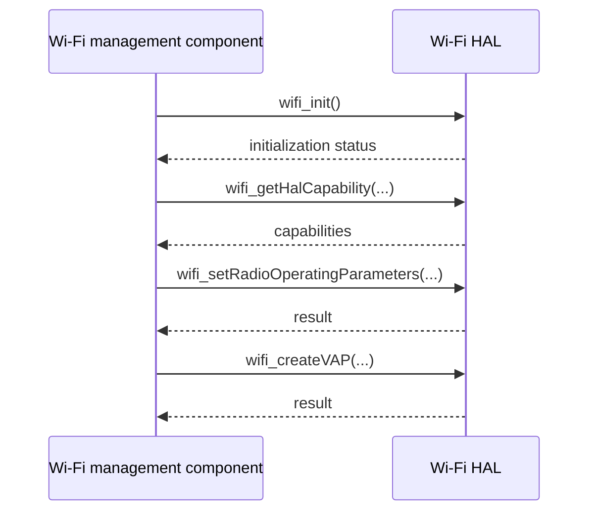

# Wi-Fi HAL Specification

## Version History

| Date | Comment | Version |
| --- | --- | --- |
| 2022-08-16 | Initial specification. | — |
| — | Documentation alignment; no ABI change. | — |

## Acronyms
HAL means Hardware Abstraction Layer; RDK-B means Reference Design Kit for Broadband; OEM means Original Equipment Manufacturer; SoC means System on a Chip; VAP means Virtual Access Point; STA means station; AP means Access Point.

## Description
The Wi-Fi management component uses this HAL to abstract platform-specific radio and driver operations for RDK-B. `wifi_hal.h` is the umbrella for the modular interface and deprecated compatibility declarations; the emulator header is separate.

## Optional Components
Vendor integration may use `hostapd` and `nl80211/cfg80211`. Their presence is not a portable guarantee for every implementation.

## Component Runtime Execution Requirements
### Initialization and Startup
Call `wifi_init()` before dependent operations. The platform boot sequence must establish driver dependencies. Query `wifi_getHalCapability()` before choosing supported radio and VAP configurations.
### Threading Model
The Wi-Fi specification expects thread-safe operation. Vendor implementations may create supporting threads.
### Process Model
One initialized HAL instance is expected for the system integration, with process-lifetime library state.
### Memory Model
The party allocating memory owns it unless an individual API specifies otherwise. Several interfaces return arrays through double pointers: follow their specific ownership and count contracts, not an assumed universal allocator rule.
### Power Management Requirements
Radio controls affect transmission; `wifi_down()` is not a general process-resource deallocator.
### Asynchronous Notification Model
Use the declared registration callbacks for management frames, client association/deauthentication/disassociation, station connection, scans, and other events. Copy callback data needed beyond callback execution unless its contract grants a longer lifetime.
### Blocking Calls
Follow per-function execution annotations: operations marked nonblocking must not suspend or invoke blocking system calls.
### Internal Error Handling
Check documented error codes before using output or continuing dependent operations.
### Persistence Model
Upper layers maintain Wi-Fi configuration unless individual API documentation explicitly requires persistence for a field.

## Nonfunctional Requirements
### Logging and Debugging
Implementations must not log credentials, secrets, security-sensitive information, or other sensitive data. Log operation outcomes rather than payloads.
### Memory and Performance
Keep the idle and standby footprint minimal.
### Quality Control
Use compiler warnings, static analysis, and memory tools. Exercise invalid inputs and hardware-qualified worst cases, with safe configuration restoration.
### Licensing
See repository Apache-2.0 notices.
### Build Requirements
Build with the product's Linux toolchain and implementation dependencies. This header repository does not by itself provide a complete vendor Wi-Fi implementation.
### Variability Management
Honor actual compile-time guards and `wifi_getHalCapability()` output. Do not use illustrative configuration flags or enum membership as proof of runtime support.

## Interface API Documentation
The [complete symbol index](halApiIndex.md) mentions every function declaration found in the public headers, grouped by contract. It links the field-level inline documentation for signatures, argument directions, bounds, units, returns, execution, side effects, and feature gates.

Prefer active interfaces for new consumers. Emulator helpers are not production HAL requirements.

### Theory of Operation and Key Concepts
Initialize, discover capabilities, configure radio operating parameters, and create VAPs. Radio indices, AP/VAP indices, and station identifiers have different roles. Do not assume enabling a configuration proves associated-client connectivity.

### Sequence Diagram

## Source References
- [wifi_hal.h](https://github.com/rdkcentral/rdkb-halif-wifi/blob/develop/include/wifi_hal.h)
- [wifi_hal_generic.h](https://github.com/rdkcentral/rdkb-halif-wifi/blob/develop/include/wifi_hal_generic.h)
- [wifi_hal_radio.h](https://github.com/rdkcentral/rdkb-halif-wifi/blob/develop/include/wifi_hal_radio.h)
- [wifi_hal_ap.h](https://github.com/rdkcentral/rdkb-halif-wifi/blob/develop/include/wifi_hal_ap.h)
- [wifi_hal_sta.h](https://github.com/rdkcentral/rdkb-halif-wifi/blob/develop/include/wifi_hal_sta.h)
- [wifi_hal_client_mgt.h](https://github.com/rdkcentral/rdkb-halif-wifi/blob/develop/include/wifi_hal_client_mgt.h)
- [wifi_hal_extender.h](https://github.com/rdkcentral/rdkb-halif-wifi/blob/develop/include/wifi_hal_extender.h)
- [wifi_hal_telemetry.h](https://github.com/rdkcentral/rdkb-halif-wifi/blob/develop/include/wifi_hal_telemetry.h)
- [wifi_hal_deprecated.h](https://github.com/rdkcentral/rdkb-halif-wifi/blob/develop/include/wifi_hal_deprecated.h)
- [wifi_hal_emu.h](https://github.com/rdkcentral/rdkb-halif-wifi/blob/develop/include/wifi_hal_emu.h)
